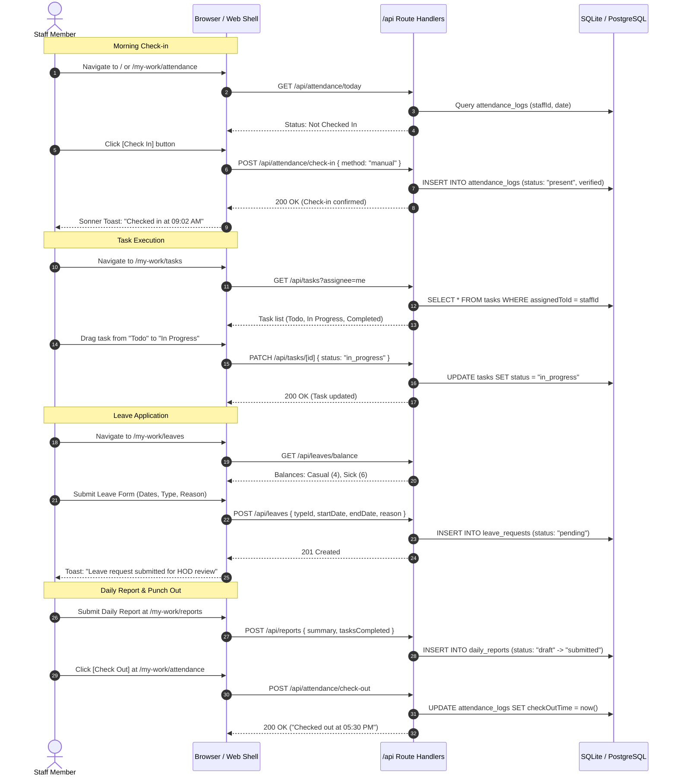
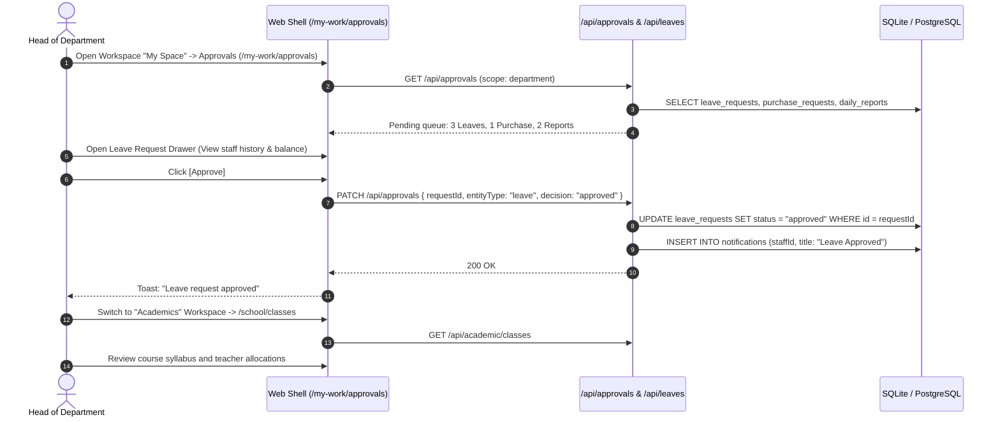
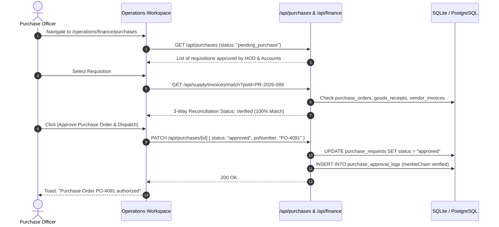
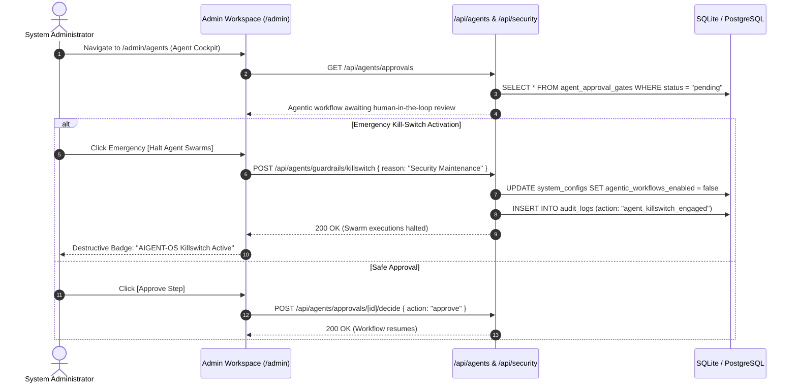

# App Flow — ThaibaHive End-to-End User Journeys

> **Complete screen-to-screen user journeys, workspace navigation, and state machines.**  
> Derived directly from `src/config/navigation.ts`, the 152 pages under `src/app/(shell)/`, and the 694 API endpoints in `src/app/api/`.

---

## 1. Workspace Navigation Map (Role & Permission Gated)

ThaibaHive organizes all application surfaces into **4 distinct workspaces** configured in [`src/config/navigation.ts`](file:///d:/ThaibaHive/src/config/navigation.ts):

```
ThaibaHive Application Shell
│
├── 📂 Workspace 1: "My Space" (my-work) ─────────────── [All Authenticated Roles]
│   ├── /                               Dashboard (Personal metrics, daily punches, quick actions)
│   ├── /my-work/attendance             Attendance (Self attendance logs, punch history, percentage)
│   ├── /my-work/tasks                  Tasks (Kanban board, todo/in-progress/completed)
│   ├── /my-work/leaves                 Leaves (Balance view, application form, approval tracking)
│   ├── /my-work/reports                Reports (Daily work summary submission)
│   ├── /my-work/approvals              Approvals [HOD, Principal, Admin, Super Admin] (Permission: approvals:approve)
│   ├── /my-work/canteen                Canteen (Meal passes, pre-order cafeteria menu)
│   ├── /my-work/timeline               Timeline (Chronological department activity stream)
│   ├── /my-work/announcements          Announcements (Institutional notices & circulars)
│   ├── /my-work/events                 Events (Academic & administrative event calendar)
│   ├── /my-work/circulars              Circulars (Official compliance documents)
│   ├── /my-work/polls                  Polls (Institutional surveys & voting)
│   ├── /my-work/chat                   Chat (Internal direct messages & channels)
│   ├── /my-work/expenses               Expenses (Reimbursement claims submission)
│   ├── /my-work/availability           Availability (Working hours status & time-off indicators)
│   ├── /my-work/recognition            Recognition (Peer kudos & employee recognitions)
│   └── /my-work/grievances             Grievances (Confidential grievance submission)
│
├── 📂 Workspace 2: "Academics" (school) ─────────────── [Teacher, HOD, Principal, Admin, Super Admin, Coordinator, Exam Coordinator]
│   ├── /school                         Academic Dashboard (Overview of enrollment, attendance & classes)
│   ├── /school/students                Students (Student registry, guardian relations, admission)
│   ├── /school/classes                 Classes (Class sections, rosters & curricular tracks)
│   ├── /school/examinations            Examinations (Exam schedules, hall tickets, mark moderation)
│   ├── /school/academic-years          Academic Years (Terms, semesters, calendar holidays)
│   ├── /school/timetable               Timetable (Period schedules, room bookings, substitutions)
│   └── /school/grades                  Grades & Report Cards (Tabulation registers, grade generation)
│
├── 📂 Workspace 3: "Operations" (operations) ────────── [Purchase, Accounts, Principal, Admin, Super Admin, Regional Admin]
│   ├── /operations                     Operations Dashboard (Logistics & financial overview)
│   ├── /operations/finance             Finance Dashboard (Fee collections, ledgers) (Permission: finance:read)
│   ├── /operations/finance/tax         Tax Rates (Jurisdiction base rates & overrides) (Permission: finance:tax:view)
│   ├── /operations/finance/purchases   Purchase Approvals (Multi-stage procurement tiers)
│   ├── /operations/finance/payroll     Payroll (Salary structures & statutory deductions) (Permission: finance:payroll:view)
│   ├── /operations/finance/reconciliation 3-Way Reconciliation (Bank, claim, fee ledgers) (Permission: finance:reconciliation:view)
│   ├── /operations/fleet               Fleet Management (Vehicles, dispatch logs, route tracking)
│   ├── /operations/assets              Asset Tracking (Institutional assets, maintenance history)
│   ├── /operations/procurement         Procurement (Vendor contracts, purchase orders, bids)
│   ├── /operations/facilities          Facilities (Preventive maintenance, room availability)
│   ├── /operations/bookings            Bookings (Auditorium, lab & resource reservations)
│   ├── /operations/accounts            Accounts (Financial ledger, expense transactions)
│   ├── /operations/finance-audit       Finance Audit (Cryptographic ledger integrity & compliance)
│   ├── /operations/finance-requests    Finance Requests (Disbursement requests & petty cash)
│   ├── /operations/visitors            Visitors (Gate check-in/out, visitor pass issuance)
│   ├── /operations/media-library       Media Library (MediaHive asset repository & storage)
│   ├── /operations/workflow-studio     Workflow Studio (Visual DAG agent workflow designer) (Permission: workflow_studio:read)
│   ├── /operations/live-sessions       Live Sessions (Multimodal duplex streaming cockpit) (Permission: live_stream:view)
│   └── /operations/conferencing        Conferencing (WebRTC rooms, participant management) (Permission: conference:join)
│
└── 📂 Workspace 4: "Admin" (admin) ─────────────────── [Admin, Super Admin, Regional Admin, Regional Auditor]
    ├── /admin                          Admin Dashboard (Telemetry, system health, institution matrix)
    ├── /admin/agents                   Agent Cockpit (AIGENT-OS guardrails, killswitch, telemetry) (Permission: agent:workflows:view)
    ├── /admin/hardware                 Hardware Management (NFC cards, biometrics, gate controllers)
    ├── /admin/audit                    Audit Ledgers (Merkle audit trees, immutable forensics) (Permission: admin:audit)
    ├── /admin/institutions             Institutions & Tenant Settings (Multi-tenant config, clusters)
    ├── /admin/security                 Security Center (Zero-trust ZASM policies, mTLS, certificates) (Permission: system:security:view)
    ├── /admin/keys                     Key Management [Super Admin Only] (Crypto-shredding keys, rotation) (Permission: system:admin)
    ├── /admin/staff                    Staff Directory (Employee profiles, departments, credentials)
    ├── /admin/marketplace              Marketplace (Institutional app directory & utilities)
    ├── /admin/agent-marketplace        Agent Marketplace (Sandboxed agent plugins & review) (Permission: marketplace:plugins:read)
    ├── /admin/sis                      SIS & LMS Standards (Ed-Fi, OneRoster, CSV connectors) (Permission: sis:read)
    ├── /admin/cross-campus             Cross-Campus Federation (Shared resource pools, inter-campus booking) (Permission: crosscampus:read)
    └── /admin/docs                     Documentation (Platform guides, runbooks & API docs)
```

---

## 2. Core User Journeys

### 2.1 General Staff Member — Daily Workflow


---

### 2.2 Department Head (HOD) — Approval & Supervision Workflow


---

### 2.3 Procurement & Finance Officer — 3-Way Match & PO Approval


---

### 2.4 System Administrator — Security & Agent Guardrails


---

## 3. Cross-Cutting System Flows

### 3.1 Authentication & Session Life-Cycle
```
/auth/login 
  ├── Form Submit: POST /api/auth/login { email, password, rememberMe }
  ├── Verify password hash with bcryptjs
  ├── Verify staff.status === "active"
  ├── Create JWT SessionPayload (HS256)
  ├── Set httpOnly cookie 'session' (sameSite: "strict", maxAge: 24h or 7d)
  └── Redirect to / (Dashboard in "My Space" workspace)

Session Validation (Every Protected Route & API Call):
  ├── Middleware / Proxy check: src/proxy.ts validates route
  ├── Route Handler: requireAuth() verifies JWT
  ├── DB Token Version Check: Invalidate immediately if staff.tokenVersion changed
  ├── Active Tenant Resolution: resolveInstitutionScopeForSession(session, host)
  └── On Failure: 401 Unauthorized → Clear cookie → Client redirects to /auth/login

Real-Time Session Invalidation:
  └── Event stream at /api/realtime/events pushes { type: "session_invalidated" } on password reset or remote logout
```

### 3.2 Real-Time Event Streaming & Notifications
- **Server-Sent Events (SSE)**: Long-lived SSE connection at `/api/workspaces/sse` and `/api/realtime/events`.
- **Badge Polling**: Secondary client polling at `/api/notifications/unread-count` every 30 seconds as network fallback.
- **Push Notifications**: Companion mobile devices receive FCM notifications via registration at `/api/notifications/device-token`.

### 3.3 Global Command Palette (Cmd+K / Ctrl+K)
- **Keyboard Shortcut**: `Cmd+K` (macOS) / `Ctrl+K` (Windows/Linux) opens `<CommandPalette>`.
- **Search API**: Debounced queries dispatched to `/api/search` and `/api/search/suggestions`.
- **Permission Filtering**: Search results are pre-filtered against the user's role and granted permissions.

### 3.4 Data Export Engine
- **Streaming Export**: Handled via `/api/export/stream` using Node.js readable streams for zero memory overhead.
- **Async Batch Jobs**: Heavy exports (e.g. multi-campus examination tabulation or annual financial ledgers) run asynchronously via `/api/export/jobs`.

---

## 4. Mobile Platform Flows (Companion App & PWA)

### 4.1 Flutter Companion App Authentication Handoff
```
Flutter App Launch
  ├── Check FlutterSecureStorage for JWT
  ├── If valid: Open WebView pointing to thaibahive.com
  └── If invalid / expired:
        ├── Show native Flutter login screen
        ├── Authenticate credentials against POST /api/auth/login
        ├── Request Single-Use Nonce: POST /api/auth/mobile-handoff/nonce
        ├── Nonce validated in Redis/SQLite (used_nonces table)
        └── Nonce exchanged to inject secure session cookie into WebView
```

### 4.2 Mobile Navigation Structure
- **Bottom Navigation Bar**: 4 primary quick-tabs mapped to `primaryNav` from `navigation.ts`:
  1. `Dashboard` (`/`)
  2. `Attendance` (`/my-work/attendance`)
  3. `Tasks` (`/my-work/tasks`)
  4. `Leaves` (`/my-work/leaves`)
- **Workspace Switcher**: Accessible via the top AppBar drawer to jump between "My Space", "Academics", "Operations", and "Admin".

---

## 5. Entity State Machines

### 5.1 Leave Request
```
[DRAFT] ──submit──> [PENDING] ──hod_approve──> [APPROVED]
                        │
                        ├──hod_reject───────> [REJECTED]
                        └──staff_cancel─────> [CANCELLED]
```

### 5.2 Task Lifecycle
```
[TODO] ──start──> [IN_PROGRESS] ──finish──> [COMPLETED]
   ▲                     │                       │
   └───────reopen────────┴───────────────────────┘
```

### 5.3 Daily Report Workflow
```
[DRAFT] ──submit──> [SUBMITTED] ──review_approve──> [APPROVED]
                           │
                           └──request_changes────> [CHANGES_REQUESTED]
                                                           │
                                                           └──resubmit──> [SUBMITTED]
```

### 5.4 Multi-Stage Purchase Requisition
```
[DRAFT] ──submit──> [PENDING_HOD] ──approve──> [PENDING_ACCOUNTS] ──approve──> [PENDING_PURCHASE] ──approve──> [APPROVED]
                         │                             │                               │
                         └──────────reject─────────────┴────────────reject─────────────┴──────────reject───> [REJECTED]
```

### 5.5 Help Desk Ticket
```
[OPEN] ──assign──> [IN_PROGRESS] ──resolve──> [RESOLVED] ──confirm──> [CLOSED]
                         ▲                         │
                         └────────reopen───────────┘
```

---

## 6. Complete API Module Directory (88 Modules, 694 Route Handlers)

The application features **694 route.ts endpoints** grouped under **88 top-level modules** in `src/app/api/`:

| Module | Route Handlers | Primary Endpoints & Operations |
|---|---|---|
| `/api/academic` | 9 | Academic years, classes, class sections, student bulk attendance |
| `/api/accounts` | 3 | Account balances, ledger summaries, account details |
| `/api/activity-logs` | 1 | Audit activity stream |
| `/api/admin` | 148 | Central administration: agent rules, institutions, departments, shifts, system settings |
| `/api/agent-plugins` | 6 | Sandboxed agent plugin installations, approvals, reviews |
| `/api/agents` | 14 | AIGENT-OS workflow execution, approval gates, killswitch, vector memory |
| `/api/ai` | 13 | Copilot voice sessions, Merkle audit, document embeddings, RAG corpus |
| `/api/alumni` | 13 | Alumni directory, chapters, donation campaigns, mentorship programs |
| `/api/analytics` | 8 | At-risk student predictions, performance analytics, batch compilation |
| `/api/announcements` | 3 | Announcement CRUD, mark as read, audience targeting |
| `/api/approvals` | 2 | Unified approval queue, delegation management |
| `/api/assets` | 5 | Institutional asset registry, stats, service history, checkout |
| `/api/attendance` | 9 | Check-in, check-out, personal history, department logs, violations |
| `/api/auth` | 31 | Login, signup, logout, session verification, SAML/OIDC, WebAuthn, DPoP |
| `/api/availability` | 2 | Working-hours availability status, department roster |
| `/api/biometric` | 3 | Face & fingerprint template verification, terminal settings |
| `/api/bookings` | 3 | Resource reservations, booking calendars, cancellations |
| `/api/canteen` | 6 | Cafeteria menus, meal passes, redemption verification |
| `/api/chat` | 17 | Direct messaging, channel management, message receipts |
| `/api/checklists` | 6 | Onboarding/offboarding checklist templates & assignments |
| `/api/circulars` | 4 | Official circular library, download tracking, compliance receipts |
| `/api/cron` | 1 | Scheduled background presence sweep & maintenance |
| `/api/cross-campus` | 5 | Inter-institution shared resources & facility booking |
| `/api/curriculum` | 10 | Curricular graph (DAG), degree plans, prerequisite auditing |
| `/api/dashboard` | 1 | Personalized dashboard KPI aggregations |
| `/api/departments` | 1 | Department registry & institution linkages |
| `/api/docgen` | 7 | PDF generation, batch certificate signing, mobile document sync |
| `/api/eco` | 9 | Microgrid energy telemetry, carbon offset calculation, EV dispatch |
| `/api/engage` | 11 | Stakeholder multi-modal messaging, campaigns, translation |
| `/api/events` | 3 | Calendar events, RSVP management |
| `/api/examinations` | 11 | Exam schedules, hall ticket generation, mark moderation |
| `/api/expense-claims` | 2 | Staff expense reimbursement claims & receipts |
| `/api/expenses` | 2 | Re-exported expense endpoints |
| `/api/export` | 9 | Streaming exports (CSV/Excel/PDF), async background export jobs |
| `/api/facility` | 9 | Maintenance dispatch, contractor registry, equipment telemetry |
| `/api/features` | 1 | Tenant feature-flag evaluation engine |
| `/api/finance` | 25 | Fee structures, installments, online fee payments, collections aging |
| `/api/graphql` | 1 | Federated GraphQL schema endpoint |
| `/api/grievances` | 2 | Confidential workplace grievance filing & tracking |
| `/api/guardians` | 1 | Student guardian relationship management |
| `/api/hardware` | 19 | NFC card programming, biometric hardware telemetry, access control events |
| `/api/health` | 1 | System heartbeat & database readiness probe |
| `/api/help-desk` | 3 | IT/Admin support tickets & threaded comments |
| `/api/institutions` | 1 | Multi-tenant institution metadata & directory |
| `/api/km` | 8 | Knowledge Mesh: semantic Q&A, degree advising, embeddings |
| `/api/leaves` | 6 | Leave applications, balance calculation, admin leave allocations |
| `/api/live` | 4 | Real-time distance learning sessions & streaming events |
| `/api/marketplace` | 6 | App marketplace access requests & installations |
| `/api/media` | 11 | MediaHive asset management, batch downloading, chunked uploads |
| `/api/metrics` | 1 | OpenTelemetry & Prometheus scrape endpoint |
| `/api/mobile` | 26 | Mobile device management (MDM), background sync, push notification dispatch |
| `/api/neuro` | 11 | Research compute cluster GPU allocation, spot billing, job scheduling |
| `/api/notifications` | 6 | In-app notifications, mark-read, device token registration |
| `/api/onboarding` | 1 | Staff self-onboarding wizard submission |
| `/api/openapi.json` | 1 | Generated OpenAPI 3.1 contract specification |
| `/api/operations` | 15 | Cross-campus benchmarks, federated drift detection, operations audit |
| `/api/performance` | 8 | Performance appraisal cycles, employee OKRs, 360-degree feedback |
| `/api/polls` | 4 | Institutional polls, voting options, aggregate results |
| `/api/presence` | 3 | Real-time presence telemetry & subscription |
| `/api/public` | 3 | Public affiliation applications, circulars, general enquiries |
| `/api/purchases` | 3 | Purchase requests, budget checking, tier approvals |
| `/api/realtime` | 1 | Server-Sent Events stream for instant session invalidation |
| `/api/recognition` | 1 | Staff peer-to-peer kudos & achievement feed |
| `/api/reports` | 3 | Daily work report submissions, review & revisions |
| `/api/reviews` | 2 | Performance review submissions & evaluation |
| `/api/search` | 2 | Universal entity global search & typeahead suggestions |
| `/api/security` | 1 | Threat intelligence federation & IP reputation sharing |
| `/api/services` | 8 | Re-exported campus services endpoints |
| `/api/sis` | 8 | Ed-Fi, OneRoster & SIS connector synchronization |
| `/api/staff` | 6 | Staff directory, face/fingerprint enrollment, NFC card issuance |
| `/api/streaming` | 10 | WebRTC video rooms, signaling & participant state |
| `/api/students` | 2 | Student profiles, academic history, document locker |
| `/api/supply` | 14 | Vendor directory, purchase orders, 3-way invoice matching |
| `/api/sync` | 2 | Mobile offline sync: delta fetching & outbox push |
| `/api/system` | 19 | Nonce cleanup, compliance snapshot diffs, cache synchronization |
| `/api/tasks` | 4 | Task creation, assignment, drag-and-drop reordering |
| `/api/telemetry` | 1 | Client performance & error telemetry ingestion |
| `/api/twin` | 10 | 3D Campus Digital Twin, spatial wayfinding, facility simulations |
| `/api/upload` | 6 | Secure file uploads: avatars, documents, attachments |
| `/api/v1` | 1 | External compliance attestation verification |
| `/api/vehicles` | 8 | Vehicle registry, trip logs, dispatch scheduling |
| `/api/verify` | 1 | Cryptographic verification of exported documents via hash |
| `/api/vision` | 9 | Vision Shield CCTV threat detection, ALPR gate control, zone management |
| `/api/visitors` | 7 | Visitor pre-registration, gate check-in/out, badge issuance |
| `/api/webhooks` | 1 | Inbound edge security & CDN threat webhooks |
| `/api/workflow-studio` | 5 | Visual DAG workflow publishing, versioning, rollback |
| `/api/workspaces` | 3 | Workspace user preferences, layout state, workspace SSE stream |
| `/api/ws` | 1 | WebSocket copilot gateway |
| **Total** | **694** | **88 Top-Level Modules** |
